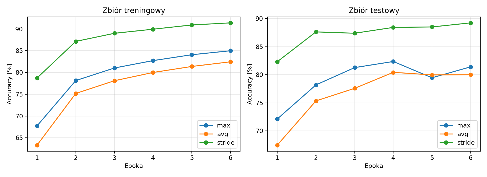

# Sprawozdanie laboratoryjne

**Przedmiot:** Uczenie głębokie do rozpoznawania obiektów  
**Zajęcia nr / temat:** 6 — Warstwa łącząca (pooling) i pełna CNN  
**Autor / grupa:** Oskar Pietrzak / Gl.03
**Data:** 24.11.2026

## 1. Cel ćwiczenia

Zbudowanie kompletnej splotowej sieci neuronowej i porównanie trzech sposobów redukcji wymiarów: max poolingu, average poolingu oraz splotu z krokiem 2. Oceniono dokładność klasyfikacji, liczbę parametrów i rozmiar map cech przed głowicą klasyfikującą.

## 2. Metoda i implementacja

Wykorzystano Python 3.12, PyTorch 2.5.1+cpu, torchvision 0.20.1+cpu i matplotlib 3.10.8. Obliczenia wykonano na CPU z dwoma wątkami. Kompletny kod i wyniki znajdują się w pliku [laboratorium_06.ipynb](laboratorium_06.ipynb).

Zbiór FashionMNIST obejmuje 60 000 obrazów treningowych i 10 000 testowych. Obrazy są jednokanałowe, mają rozmiar 28 × 28 i należą do 10 klas ubrań. Piksele przeskalowano do [0, 1], a następnie znormalizowano ze średnią 0,2860 i odchyleniem standardowym 0,3530. Nie stosowano augmentacji ani zmniejszania zbioru.

Każdy wariant zawiera dwa bloki: `Conv2d(3×3, padding=1) → BatchNorm2d → ReLU → redukcja`. Pierwszy blok ma 32 kanały, drugi 64. Max i average pooling mają okno 2 × 2 i krok 2. Wariant stride zastępuje każdy pooling dodatkowym splotem 3 × 3 o kroku 2 i dopełnieniu 1, po którym występują BatchNorm i ReLU.

| Etap | Kształt tensora |
|---|---|
| Wejście | N × 1 × 28 × 28 |
| Pierwszy blok | N × 32 × 14 × 14 |
| Drugi blok, przed głowicą | N × 64 × 7 × 7 |
| GAP | N × 64 × 1 × 1 |
| Spłaszczenie | N × 64 |
| Warstwa liniowa | N × 10 |

Głowica jest wspólna dla wszystkich wariantów:

```python
self.head = nn.Sequential(
    nn.AdaptiveAvgPool2d(1),
    nn.Flatten(),
    nn.Linear(64, 10)
)
```

Trening każdego wariantu trwał 6 epok. Zastosowano Adam z `lr=0.001`, funkcję straty `CrossEntropyLoss`, batch size 128 w treningu i 256 w teście. Przed utworzeniem każdego modelu ustawiano `torch.manual_seed(0)`, a generator tasowania danych również otrzymywał ziarno 0. Zachowano ten sam podział i kolejność partii danych dla wszystkich modeli.

```python
optimizer = torch.optim.Adam(model.parameters(), lr=0.001)
criterion = nn.CrossEntropyLoss()
```

Accuracy obliczano jako liczbę poprawnych predykcji podzieloną przez liczbę obrazów. Ewaluacja odbywała się w trybie `eval()` i `torch.inference_mode()`. W tabeli podano wynik po ustalonej szóstej epoce oraz opisowo maksimum z sześciu pomiarów testowych. Liczbę parametrów policzono przez `sum(p.numel() for p in model.parameters())`, wliczając uczone współczynniki BatchNorm, bez buforów statystyk.

## 3. Wyniki

Wszystkie wartości accuracy pochodzą z wykonanego treningu.

| Wariant | Accuracy test po 6 epokach | Najlepsza accuracy test | Liczba parametrów | Mapa cech przed głowicą |
|---|---:|---:|---:|---|
| Max pooling | 81,40% | 82,35% | 19 658 | 64 × 7 × 7 |
| Average pooling | 79,98% | 80,42% | 19 658 | 64 × 7 × 7 |
| Splot z krokiem 2 | 89,23% | 89,23% | 66 026 | 64 × 7 × 7 |

Rozmiar `64 × 7 × 7` oznacza 3136 aktywacji na obraz. Po GAP pozostają 64 cechy. Głowica liniowa zawiera `64 × 10 + 10 = 650` parametrów.

Przebieg accuracy testowej:

| Epoka | Max pooling | Average pooling | Splot z krokiem 2 |
|---:|---:|---:|---:|
| 1 | 72,11% | 67,46% | 82,31% |
| 2 | 78,18% | 75,33% | 87,62% |
| 3 | 81,26% | 77,57% | 87,38% |
| 4 | 82,35% | 80,42% | 88,42% |
| 5 | 79,45% | 79,96% | 88,50% |
| 6 | 81,40% | 79,98% | 89,23% |



*Rys. 1. Krzywe accuracy. Metryka treningowa jest zbierana podczas aktualizacji wag w epoce, a testowa po zakończeniu epoki dla ustalonego modelu. Wykres znajduje się również w notebooku.*

Jako wariant bazowy przyjęto max pooling. Average pooling uzyskał accuracy po szóstej epoce niższe o 1,42 p.p., zachowując tę samą liczbę parametrów. Splot z krokiem 2 uzyskał accuracy wyższe o 7,83 p.p. względem wariantu bazowego.

## 4. Analiza i interpretacja

Najwyższą accuracy po sześciu epokach uzyskał wariant **splot z krokiem 2 — 89,23%**. Max i average pooling mają po 19 658 parametrów, ponieważ sama operacja poolingu nie zawiera uczonych wag. Różnice ich wyników wynikają z innej agregacji aktywacji: max zachowuje lokalne maksimum, a average uśrednia całe okno i może osłabiać pojedyncze silne odpowiedzi.

Splot z krokiem 2 ma 66 026 parametrów, czyli o 46 368 więcej i około 3,36 raza tyle co warianty z poolingiem. Dodatkowe parametry należą do dwóch splotów redukujących wymiar oraz ich warstw BatchNorm. Redukcja jest uczona, lecz porównanie obejmuje całe warianty architektury: różnią się również głębokością i liczbą wag. Sam wzrost liczby parametrów nie gwarantuje proporcjonalnej poprawy accuracy.

Każdy wariant redukuje rozmiar przestrzenny 28 → 14 → 7, dlatego różnic wyników nie wyjaśnia rozmiar końcowej mapy. GAP ogranicza głowicę do 650 parametrów. Bezpośrednie `Flatten → Linear(3136, 10)` wymagałoby 31 370 parametrów w samej głowicy. Jest to porównanie liczby wag; takiej dodatkowej głowicy nie trenowano. Ceną GAP jest utrata informacji o dokładnym położeniu aktywacji wewnątrz kanału.

Przeprowadzono jeden trening każdego wariantu i tylko sześć epok, więc wyniki opisują ten konkretny przebieg. Maksimum testowe jest statystyką opisową, a nie niezależnym oszacowaniem po wyborze najlepszej epoki. Do strojenia należałoby wydzielić walidację ze zbioru treningowego i użyć testu dopiero do końcowej oceny. Nie wyznaczano macierzy pomyłek, dlatego nie wskazywano konkretnych par błędnie rozpoznawanych klas.

## 5. Wnioski

1. Wszystkie trzy sposoby redukcji pozwoliły zbudować kompletną CNN z mapą cech 64 × 7 × 7 i wyjściem dla 10 klas.
2. W wykonanym eksperymencie najwyższy wynik po ustalonych sześciu epokach osiągnął wariant splot z krokiem 2. Max i average pooling umożliwiają porównanie agregacji bez zmiany liczby parametrów.
3. Wariant stride zwiększa liczbę parametrów o około 236%. Oceniając jego opłacalność, trzeba zestawić uzyskaną zmianę accuracy z tym wzrostem kosztu modelu.
4. GAP zmniejsza liczbę parametrów głowicy i pozwala uniknąć rozbudowanej warstwy gęstej. Dalsze badania mogą objąć dłuższy trening, kilka ziaren losowych oraz porównanie GAP ze spłaszczeniem.
