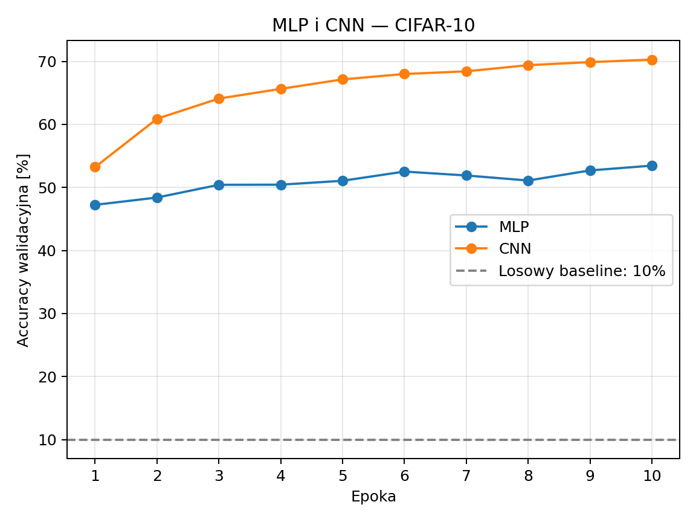

# Sprawozdanie laboratoryjne

**Przedmiot:** Uczenie głębokie do rozpoznawania obiektów  
**Zajęcia nr / temat:** 4 — CNN: splotowe sieci dla obrazów  
**Autor / grupa:** Oskar Pietrzak / nie podano  
**Data:** 09.11.2026

## 1. Cel ćwiczenia

Celem było zbudowanie prostej sieci splotowej CNN i porównanie jej z siecią MLP na CIFAR-10. Porównano końcową accuracy testową, liczbę parametrów i czas uczenia przy jednakowej liczbie epok, optymalizatorze oraz podziale danych. Zrealizowano zakres obowiązkowy.

## 2. Metoda i implementacja

Wykorzystano Python 3.12, PyTorch 2.15.0+cpu, torchvision 0.29.2+cpu i matplotlib. Kod oraz zapisane wyniki znajdują się w [lab4_cnn_mlp.ipynb](lab4_cnn_mlp.ipynb).

CIFAR-10 zawiera 60 000 kolorowych obrazów 32 × 32 piksele, należących do 10 klas. Oficjalne 50 000 obrazów treningowych podzielono losowo na trening (45 000) i walidację (5 000), z ziarnem 42. Oficjalne 10 000 obrazów testowych zachowano do końcowej oceny. Oba modele otrzymały identyczny podział i kolejność minibatchy.

Przetwarzanie obejmowało `ToTensor()` i normalizację kanałów: średnie (0,4914; 0,4822; 0,4465), odchylenia standardowe (0,2470; 0,2435; 0,2616). Nie stosowano augmentacji.

| Ustawienie | Wartość |
|---|---|
| Epoki | 10 dla każdego modelu |
| Optymalizator | Adam |
| Learning rate | 0,001 |
| Batch size | 128 |
| Funkcja straty | CrossEntropyLoss |
| MLP | Flatten → Linear(3072, 512) → ReLU → Linear(512, 256) → ReLU → Linear(256, 10) |
| CNN | Conv(3→16) → ReLU → MaxPool → Conv(16→32) → ReLU → MaxPool → Flatten → Linear(2048, 64) → ReLU → Linear(64, 10) |
| Sploty / pooling | Jądro 3 × 3, padding 1 / MaxPool 2 × 2 |
| Wybór stanu modelu | Najwyższa accuracy walidacyjna; przy remisie wcześniejsza epoka |

Trening wykonano na **CPU AMD EPYC 9V74**, przy 4 wątkach obliczeniowych PyTorch (środowisko udostępniało 9 procesorów logicznych). GPU nie było dostępne, więc pomiar odbiega od zalecenia wykonywania treningu CNN na GPU. Notebook automatycznie używa CUDA, jeśli jest dostępna; pomiar na GPU wymaga ponownego uruchomienia np. w Colabie.

Czas mierzono przez `time.perf_counter()` od rozpoczęcia pętli uczenia do zakończenia ostatniej walidacji. Obejmuje wszystkie 10 epok, walidację po każdej epoce oraz kopiowanie najlepszego stanu. Nie obejmuje pobierania danych, tworzenia modelu ani końcowego testu. Dla CUDA kod synchronizuje urządzenie na granicach pomiaru. Po treningu przywracany jest wybrany stan i wykonywana jest jedna ocena testowa dla każdego modelu.

## 3. Wyniki

Poniższe wartości pochodzą z rzeczywiście wykonanego treningu. Accuracy testowa dotyczy stanu wybranego na walidacji; czas obejmuje cały budżet 10 epok.

| Model | Liczba parametrów | Końcowa accuracy testowa | Czas uczenia [s] | Wybrana epoka | Accuracy walidacyjna wybranego stanu |
|---|---:|---:|---:|---:|---:|
| MLP | 1 707 274 | 53,23% | 79,4 | 10 | 53,46% |
| CNN | 136 874 | 69,26% | 106,0 | 10 | 70,28% |

Wartości źródłowe zapisano w [wyniki.csv](wyniki.csv).

**Rysunek 1.** Krzywe accuracy walidacyjnej obu modeli w kolejnych epokach. Linia przerywana oznacza teoretyczny losowy baseline 10%. Krzywe nie przedstawiają testu: ten zbiór nie uczestniczył w wyborze epoki.

Losowy wybór jednej z 10 klas daje oczekiwaną accuracy 10%. MLP osiągnęła wynik o 43,23 p.p. powyżej tego poziomu, a CNN o 59,26 p.p.

## 4. Analiza i interpretacja

CNN uzyskała accuracy testową wyższą od MLP o **16,03 punktu procentowego**. W tym eksperymencie wykorzystanie lokalnej struktury obrazu było korzystne.

MLP spłaszcza obraz do 3072 wartości i wykorzystuje połączenia pełne. Nie narzuca lokalnych połączeń odpowiadających sąsiedztwu pikseli. CNN analizuje niewielkie fragmenty obrazu za pomocą filtrów 3 × 3. Współdzielenie wag pozwala szukać tego samego wzorca w różnych położeniach, a kolejne warstwy mogą łączyć proste wzorce w bardziej złożone cechy. Pooling zmniejsza rozmiary map cech i ogranicza rozmiar części w pełni połączonej.

CNN miała **o 91,98% mniej parametrów** niż MLP. Stosunek czasu uczenia CNN do MLP wyniósł **1,33**. Liczba parametrów nie określa bezpośrednio czasu obliczeń: każdy filtr splotowy stosowany jest wielokrotnie w różnych położeniach obrazu. Pomiar zależy też od sprzętu, implementacji operatorów i kosztu przygotowania minibatchy; uzyskane czasy dotyczą CPU i nie przewidują czasów na GPU.

Ograniczenia: pojedynczy podział i pojedyncze uruchomienie dla każdej architektury, brak oceny zmienności między ziarnami oraz tylko 10 epok. Porównanie dotyczy dwóch konkretnych konfiguracji, a nie wszystkich MLP i CNN. Nie analizowano poszczególnych błędnych predykcji, dlatego nie można wskazać najczęściej mylonych klas. Oddzielna walidacja ograniczyła ryzyko dobierania epoki do wyników testowych.

## 5. Wnioski

1. CNN uzyskała wyższą końcową accuracy testową niż MLP przy tym samym budżecie epok i optymalizatorze.
2. Lokalność i współdzielenie wag pozwoliły zastosować CNN mającą znacznie mniej parametrów niż MLP.
3. Jakość i koszt trzeba oceniać oddzielnie: liczba parametrów nie zastępuje pomiaru czasu uczenia.
4. Dalsze badania mogą obejmować trening na GPU, powtórzenia z różnymi ziarnami i strojenie liczby filtrów na zbiorze walidacyjnym.
