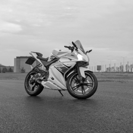
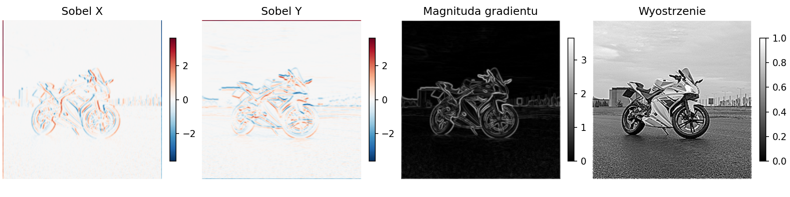
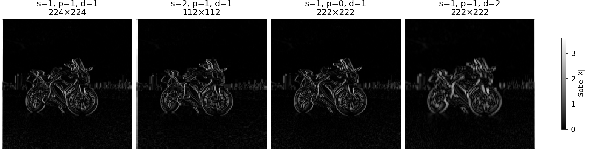
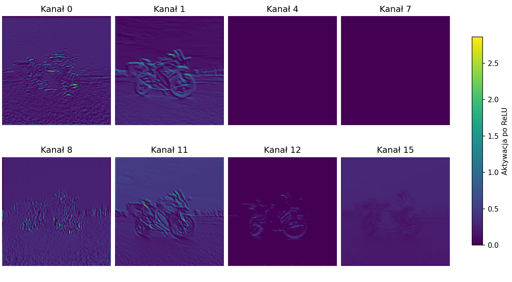
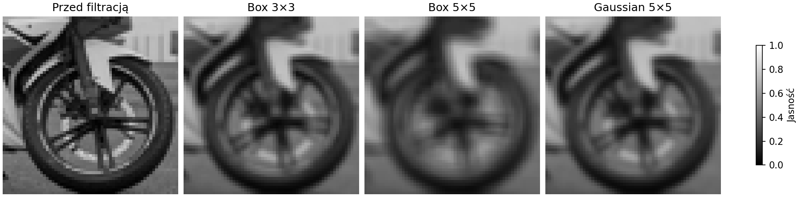

# Sprawozdanie laboratoryjne

**Przedmiot:** Uczenie głębokie do rozpoznawania obiektów  
**Zajęcia nr / temat:** 5 — Warstwy splotowe — operacja, parametry, interpretacja  
**Autor / grupa:** Oskar Pietrzak / …  
**Data:** 20.11.2026

## 1. Cel ćwiczenia

Celem ćwiczenia było zbadanie, jak ręcznie dobrane jądra filtrują obraz i jak parametry splotu wpływają na rozmiar oraz wygląd mapy wyjściowej. Porównano trzy filtry rozmywające i zinterpretowano wybrane mapy cech pretrenowanego ResNet-18.

## 2. Metoda i implementacja

We wszystkich eksperymentach wykorzystano ten sam kwadratowy kadr zdjęcia motocykla autora, przeskalowany do 224 × 224 pikseli i przekonwertowany do skali szarości. Jasność przeliczono na zakres od 0 do 1.

Obliczenia wykonano w PyTorch i torchvision, a wykresy przygotowano w Matplotlib. Kod i zapisane wyniki są w [notebooku](laboratorium_05_splot.ipynb).

- Jądra Sobel X, Sobel Y i Sharpen zastosowano przez `F.conv2d` z dopełnieniem 1. Magnitudę gradientu obliczono jako $\sqrt{G_x^2+G_y^2}$. Dla obu map Sobela zastosowano tę samą skalę wyśrodkowaną w zerze. Wyostrzony obraz ograniczono do zakresu [0, 1].
- Rozmiar wyjścia obliczono osobno dla wysokości i szerokości ze wzoru $\lfloor (N+2p-d(k-1)-1)/s \rfloor+1$, gdzie $N$ jest wymiarem wejścia, $k$ rozmiarem jądra, $s$ krokiem, $p$ dopełnieniem, a $d$ dylatacją. Wyniki zweryfikowano przez `nn.Conv2d`.
- Do ResNet-18 z wagami ImageNet przekazano trzy kopie obrazu w skali szarości. Następnie użyto średnich i odchyleń standardowych ImageNet dla poszczególnych kanałów. Odczytano mapy po pierwszym splocie, normalizacji wsadowej i ReLU. Model był w trybie ewaluacji.
- Filtry rozmywające miały krok i dylatację równe 1. Dopełnienie wyniosło 1 dla Box 3×3 oraz 2 dla obu jąder 5×5. Box używał wag odpowiednio 1/9 i 1/25. Gaussian 5×5 utworzono z iloczynu zewnętrznego wektora [1, 4, 6, 4, 1] podzielonego przez 256.

## 3. Wyniki

### Ręczne jądra

### Weryfikacja wzoru na wymiary

| Rozmiar jądra $k$ | Krok $s$ | Dopełnienie $p$ | Dylatacja $d$ | Ze wzoru | Z `nn.Conv2d` |
|---:|---:|---:|---:|---:|---:|
| 3 | 1 | 1 | 1 | 224 × 224 | 224 × 224 |
| 3 | 2 | 1 | 1 | 112 × 112 | 112 × 112 |
| 3 | 1 | 0 | 1 | 222 × 222 | 222 × 222 |
| 3 | 1 | 1 | 2 | 222 × 222 | 222 × 222 |
| 5 | 1 | 2 | 1 | 224 × 224 | 224 × 224 |
| 3 | 1 | 2 | 2 | 224 × 224 | 224 × 224 |

### Wpływ kroku, dopełnienia i dylatacji

### Mapy cech ResNet-18

Pierwszy blok zwrócił 64 mapy o wymiarach 112 × 112. Poniżej pokazano osiem kanałów na wspólnej skali aktywacji.

### Porównanie filtrów rozmywających

Po filtracji każdy obraz zachował rozmiar 224 × 224. Na wszystkich panelach pokazano ten sam fragment przedniego koła na wspólnej skali jasności 0–1.

## 4. Analiza i interpretacja

**Ręczne jądra.** Sobel X uwydatnił pionowe fragmenty obręczy i słupki w tle, ponieważ mierzy zmiany jasności w poziomie. Sobel Y wyraźniej zaznaczył linię horyzontu i poziome odcinki owiewki. Magnituda połączyła oba kierunki i odtworzyła obrys motocykla. Wyostrzenie zwiększyło lokalny kontrast szprych, owiewek i faktury asfaltu. Linie na zewnętrznych brzegach map Sobela wynikają z przejścia między zdjęciem a zerowym dopełnieniem.

**Parametry splotu.** Krok 2 zmniejszył oba wymiary z 224 do 112, przez co zarys drobnych detali stał się bardziej pikselowy. Usunięcie dopełnienia dało 222 × 222 i usunęło skrajną odpowiedź wynikającą z zer poza obrazem. Dylatacja 2 przy kroku 1 zwiększyła zakres próbkowania jądra do 5 × 5. Przy dopełnieniu 1 także dała 222 × 222, ale pasma przy konturach kół i owiewek stały się szersze. Podniesienie dopełnienia do 2 przywróciło rozmiar 224 × 224.

**Mapy sieci.** Kanał 1 uwydatnił poziome fragmenty horyzontu i części motocykla. Kanał 8 reagował między innymi na pionowe słupki w tle i fragmenty w obrębie kół. Kanał 11 zaznaczył skośne krawędzie owiewek oraz fragmenty przedniego koła. Kanał 12 aktywował się głównie na wybranych częściach obręczy i kilku jasnych detalach motocykla. Kanały 4 i 7 miały bardzo słabą odpowiedź w pokazanej skali. To interpretacja reakcji na jedno zdjęcie, więc przypisanie kanałowi konkretnej orientacji wymagałoby dodatkowej próby z kontrolowanymi krawędziami.

**Rozmycie.** Po Box 3×3 ciemne szprychy nadal wyraźnie odcinają się od jasnych obszarów wewnątrz obręczy. Po Box 5×5 przejścia są szersze, a część drobnych jasnych fragmentów między szprychami zlewa się z otoczeniem. Gaussian 5×5 zachował wyraźniejsze granice szprych i opony niż Box 5×5. W Gaussian waga środka to 36/256, a waga narożnika 1/256. Box 5×5 każdej próbce nadaje wagę 1/25, przez co bardziej miesza piksele odległe od środka okna.

## 5. Wnioski

Wzór poprawnie przewidział wymiary wyjścia we wszystkich sześciu konfiguracjach. Zmiana kroku wpływała na gęstość próbkowania, dopełnienie na skrajne pozycje odpowiedzi, a dylatacja na obszar obrazu objęty jądrem. Pierwsza warstwa ResNet-18 uwydatniła różne kierunki krawędzi i lokalne detale. Przy tym samym rozmiarze okna większe wagi środka w Gaussian 5×5 pozwoliły lepiej zachować detale koła niż równomierne wagi Box 5×5.

---

## Kryteria oceny (rubryka)

| Element | Waga |
|---|---:|
| Poprawność implementacji | 40% |
| Wyniki i ich interpretacja | 30% |
| Czytelność kodu (PEP8, komentarze) | 20% |
| Wnioski | 10% |

Próg zaliczenia sprawozdań (O1) wynosi 90%. Oddanie do tygodnia po zajęciach.
